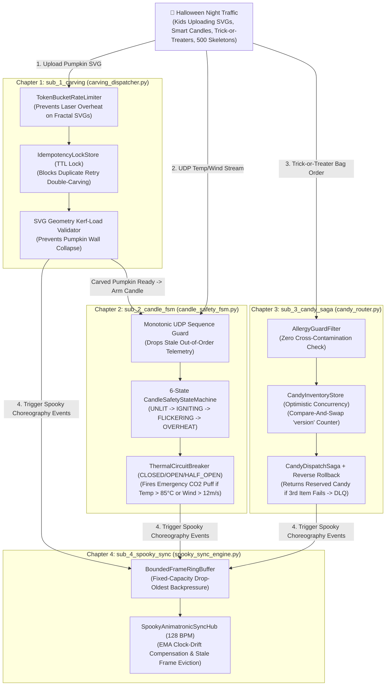
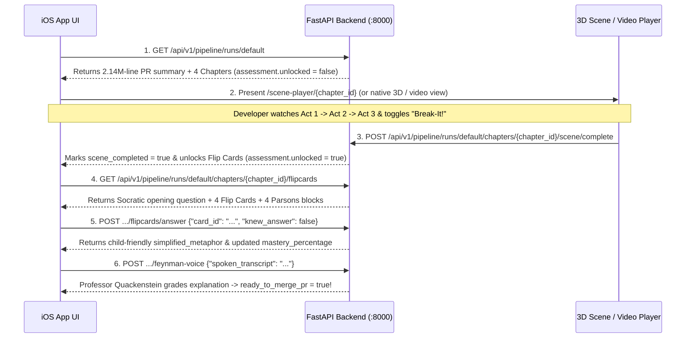

# Team Handover Guide: Video/3D Engine Team & UI Team

This document provides the complete integration contract, architecture diagrams, and storyboards connecting:
1. **Input Target Repo (`data/mock_halloween_app/`)** — The AI-generated Halloween app being reviewed.
2. **AI Didactics Backend (`backend/`)** — The 5-stage decomposition pipeline & FastAPI server.
3. **Video / 3D Cartoon Engine Team** — Consumes scene specs & renders the 3-Act animations + "Break-It" chaos mode.
4. **iOS / Frontend UI Team (`ios-ui/`)** — Displays hotspots, embeds the 3D scene/video, unlocks Flip Cards after watching, and runs the Feynman voice check.

---

## 1. Mock Target App Diagram (`data/mock_halloween_app/`)

The input repository under review is **SpookyPrep-OS** (`data/mock_halloween_app/`), simulating a massive **2,140,000-line PR** where our Stage 1 AST Map-Reduce filter isolates **4 critical AI-generated backend subsystems (~580 LOC)**:



*(For the deeper sequence diagram and subsystem breakdown, see [`data/ARCHITECTURE_HALLOWEEN_MOCK.md`](../data/ARCHITECTURE_HALLOWEEN_MOCK.md)).*

---

## 2. Handover for the VIDEO / 3D SCENE CREATION TEAM

### 2.1 How to Fetch Scene Specifications from the Backend

Start the backend server:
```bash
cd backend
uvicorn app.main:app --reload --port 8000
```

Fetch the 3D/Video specification for any of the 4 chapters:
- `GET http://127.0.0.1:8000/api/v1/chapters/sub_1_carving/scene`
- `GET http://127.0.0.1:8000/api/v1/chapters/sub_2_candle_fsm/scene`
- `GET http://127.0.0.1:8000/api/v1/chapters/sub_3_candy_saga/scene`
- `GET http://127.0.0.1:8000/api/v1/chapters/sub_4_spooky_sync/scene`

Or open the ready-made interactive Three.js WebGL player directly in your browser or `WKWebView`:
- `http://127.0.0.1:8000/scene-player/sub_1_carving`

### 2.2 JSON Contract (`Scene3DPayload`)

Each `/scene` endpoint returns:
```json
{
  "chapter_id": "sub_1_carving",
  "scene_title": "The Haunted Laser Carving Bay: Idempotency & Rate Limiting",
  "halloween_theme_setting": "Neon-lit Gothic Pumpkin Carving Foundry with conveyor belts and CO2 lasers",
  "video_storyboard_url": "/api/v1/scenes/sub_1_carving/stream.mp4",
  "interactive_player_url": "/scene-player/sub_1_carving",
  "actors": [
    {
      "actor_id": "actor_gatekeeper_bat",
      "name": "Count Ratelimit (Bouncer Bat)",
      "role_metaphor": "Token Bucket Rate Limiter guarding the factory entrance",
      "code_symbol": "TokenBucketRateLimiter.consume",
      "file_path": "mock_halloween_app/carving_dispatcher.py",
      "line_range": "L30-L51",
      "shape_type": "bouncer_bat",
      "color_hex": "#9B5DE5",
      "position": [-6.0, 0.5, 0.0]
    }
  ],
  "connections": [
    {
      "from_actor_id": "actor_gatekeeper_bat",
      "to_actor_id": "actor_lock_vault",
      "label": "Verified Burst Token -> Check Idempotency Key",
      "packet_type": "svg_carve_request",
      "color_hex": "#FF9F1C"
    }
  ],
  "steps": [
    {
      "step_index": 1,
      "act_title": "Act 1: The Trigger — Burst Upload & Token Bucket Check",
      "Active_actor_ids": ["actor_gatekeeper_bat", "actor_lock_vault"],
      "packet_flow": "actor_gatekeeper_bat -> actor_lock_vault",
      "voiceover_narration": "On Halloween night, hundreds of kids upload pumpkin designs at once...",
      "code_highlight_file": "mock_halloween_app/carving_dispatcher.py",
      "code_highlight_lines": "L39-L51",
      "code_snippet": "if self._tokens[household_id] < cost:\n    raise RateLimitExceededError(...)",
      "duration_seconds": 5.0
    }
  ],
  "break_it_mutation": {
    "mutation_id": "mut_sub_1_idempotency_removed",
    "title": "Disable Idempotency Lock Check",
    "target_file": "mock_halloween_app/carving_dispatcher.py",
    "target_line_range": "L63-L79",
    "code_line_removed": "if not self.lock_store.acquire(req.idempotency_key):",
    "what_breaks_in_code": "Concurrent client retries bypass deduplication and fire two laser rigs on the same pumpkin.",
    "cartoon_chaos_animation": "Bouncer Bat falls asleep; two orange request orbs collide inside the laser booth, slicing the pumpkin in half with a purple smoke explosion!",
    "severity": "CRITICAL"
  }
}
```

### 2.3 Textual Storyboards & Prompts for Video Generation (All 4 Scenes)

#### Scene 1 (`sub_1_carving`): "The Double-Carve Disaster"
- **Characters:** **Count Ratelimit (Bouncer Bat)** at the gate, **Crypt Ledger (Idempotency Lock Vault)**, and **Choppy-Bot (Steampunk Laser Carver)**.
- **Act 1 (0–5s):** Shaky mobile Wi-Fi causes a kid's phone to send **two identical glowing orange orbs** (`req-42` and retry `req-42`) toward the carving bay.
- **Act 2 (5–10s):** Bouncer Bat lets the first orb through and stamps `req-42` into the Golden Ledger. When the duplicate second orb arrives 10ms later, Bouncer Bat raises a glowing shield and hands back the cached receipt instead of firing the laser again.
- **Act 3 (10–15s):** Choppy-Bot verifies the pumpkin shell is thick enough (`>= 12mm`), carves a glowing vampire grin once, and saves the receipt.
- **🔥 "Break-It" Counterfactual Clip:** Toggle OFF `lock_store.acquire` $\rightarrow$ Both orbs enter the laser chamber simultaneously; crossing laser beams slice the pumpkin in half!

#### Scene 2 (`sub_2_candle_fsm`): "The Out-of-Order Wind Gust"
- **Characters:** **Jack the Smart Pumpkin**, **Sequence Guard Bat**, and **Frosty the Extinguisher Ghost (Circuit Breaker)**.
- **Act 1 (0–5s):** Jack's candle flickers normally until a `15 m/s` blue wind gust hits, spiking internal temperature to `92°C` in UDP Packet `#105`.
- **Act 2 (5–10s):** The State Machine sign flips from `FLICKERING_NORMAL` to crimson `EXTINGUISHED_LOCKOUT`. Frosty Ghost blasts a cloud of CO2 snow and trips the Circuit Breaker lever to `OPEN`.
- **Act 3 (10–15s):** A delayed green UDP packet (`Packet #102: temp 45°C`) arrives late on a snail. Sequence Guard Bat checks `102 <= 105` and swats it away so the overheated pumpkin isn't relit.
- **🔥 "Break-It" Counterfactual Clip:** Toggle OFF `packet.sequence_number <= self.last_seq` $\rightarrow$ The delayed green snail packet slips past the gate and relights the overheated pumpkin, popping its lid off like a firework!

#### Scene 3 (`sub_3_candy_saga`): "The Peanut Allergy & Empty Cauldron Saga"
- **Characters:** **Allergy Scanner Bat**, **Witch's Candy Cauldron (with spinning `v1 -> v2 -> v3` dial)**, **Chief Saga Witch**, and **DLQ Coffin Mailbox**.
- **Act 1 (0–5s):** A kid with a `"NO PEANUTS"` badge orders 3 candies. Allergy Scanner Bat checks allergen tags first.
- **Act 2 (5–10s):** Goblins reserve Candy #1 and Candy #2 from the Cauldron, clicking its version dial `v1 -> v2 -> v3` (Optimistic Concurrency CAS).
- **Act 3 (10–15s):** Candy #3 is out of stock! Chief Saga Witch blows her **Rewind Whistle**: goblins walk in reverse, returning Candy #2 and Candy #1 back into the Cauldron, and drop a scroll into the **DLQ Mailbox** for refill.
- **🔥 "Break-It" Counterfactual Clip:** Toggle OFF `_rollback_reserved` $\rightarrow$ Half-filled failed bags pile up on the floor locking all the Marshmallow Skulls so nobody else can get candy!

#### Scene 4 (`sub_4_spooky_sync`): "The 500-Skeleton Graveyard Jam"
- **Characters:** **Maestro Bone-Jangles (Skeleton Conductor)**, **4-Slot Glowing Cauldron Carousel (Bounded Ring Buffer)**, and **500 Dancing Skeletons**.
- **Act 1 (0–5s):** Maestro waves his baton at 128 BPM, broadcasting 60 glowing musical-note frames per second.
- **Act 2 (5–10s):** Skeleton #404 has weak Wi-Fi. When the 4-slot Ring Buffer fills up and Frame #5 arrives, the oldest stale frame (#1) is popped (`popleft()`) into a ghost trash bin so Skeleton #404 jumps straight to the fresh beat.
- **Act 3 (10–15s):** Frames with `> 50ms` clock drift evaporate in mid-air so the main event loop never blocks.
- **🔥 "Break-It" Counterfactual Clip:** Toggle OFF `self.buffer.popleft()` $\rightarrow$ Unbounded queue balloons into a giant mountain of old frames, crushing the Raspberry Pi controller in an **Out-Of-Memory (OOM)** explosion!

---

## 3. Handover for the UI / iOS TEAM (`ios-ui/`)

### 3.1 Ready-to-Use Swift Models & API Client
We already generated [`ios-ui/VibeDidactics/HalloweenPipelineModels.swift`](../ios-ui/VibeDidactics/HalloweenPipelineModels.swift), which includes:
- Full `Codable` structs matching every backend schema (`PipelineRunState`, `DidacticChapter`, `Scene3DPayload`, `FlipCard`, `ParsonsBlock`, `FeynmanVoiceFeedback`).
- `VibeDidacticsAPIClient` (`@MainActor ObservableObject`) with automatic fallback to `HalloweenMockData.sampleRun` when running in the Xcode Simulator without the Python server!

### 3.2 End-to-End UI Flow & REST Endpoints



### 3.3 Endpoint Quick Reference

| Step | Method & Path | Purpose |
| :--- | :--- | :--- |
| **1. Load Run** | `GET /api/v1/pipeline/runs/default` | Returns the full `PipelineRunState` (2.14M-line PR stats + 4 chapters). |
| **2. Get 3D Scene JSON** | `GET /api/v1/pipeline/runs/default/chapters/{chapter_id}/scene` | Returns `Scene3DPayload` (`actors`, `connections`, `steps`, `break_it_mutation`). |
| **2b. 3D WebGL Player** | `GET /scene-player/{chapter_id}` | Interactive HTML5/Three.js Halloween Cartoon Scene player (embed in `WKWebView`). |
| **3. Unlock Flip Cards** | `POST /api/v1/pipeline/runs/default/chapters/{chapter_id}/scene/complete` | **Gatekeeper:** Marks the 3D scene/video watched and unlocks the Flip Cards. |
| **4. Get Flip Cards** | `GET /api/v1/pipeline/runs/default/chapters/{chapter_id}/flipcards` | Returns `FlipCard[]`, `ParsonsBlock[]`, and `socratic_opening_question`. |
| **5. Swipe Flip Card** | `POST /api/v1/pipeline/runs/default/chapters/{chapter_id}/flipcards/answer` | Body: `{"card_id": "...", "knew_answer": true/false}`. Left-swipe (`false`) returns a simpler ELI5 metaphor! |
| **6. Feynman Voice Check** | `POST /api/v1/pipeline/runs/default/chapters/{chapter_id}/feynman-voice` | Body: `{"spoken_transcript": "..."}`. Returns score, matched/missing concepts, and `ready_to_merge_pr`. |
