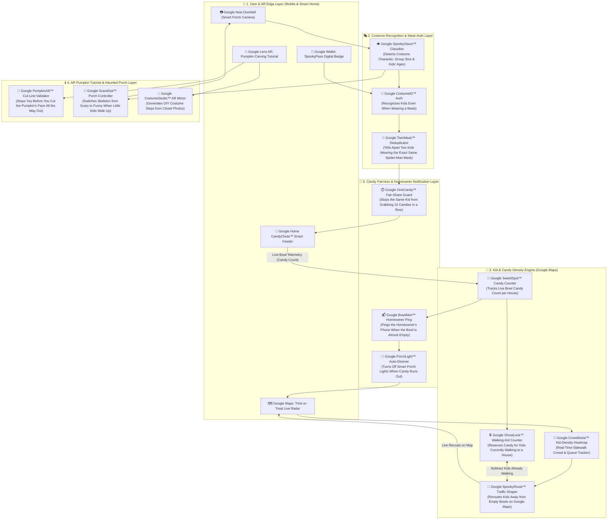

# Team Handover Guide: Google Halloween Ecosystem, 10-Second Video Scripts, Mock Questions & UI/Backend API

## 1. The Big Picture: "Google Halloween Mode" (18-Service Architecture)

### 1.1 Demo Storyline for the Hackathon Pitch
For October 31st, Google is launching a seasonal cross-product update (**"Google Halloween Mode"**) across **Google Maps, Google Lens AR, Google Nest Doorbell, Google Wallet, and Google Home Smart Candy Dispensers**.  
Developers used AI coding assistants to wire together **18 microservices** handling costume recognition, mask-invariant authentication, real-time kid/candy density on Google Maps, AR pumpkin carving tutorials, and smart porch animations.  

When the **Tech Lead** opens the PR, they are confronted with the **massive 18-service architecture diagram** below. Instead of reading thousands of lines of glue code, the Tech Lead selects a critical service interaction on the graph, watches a **10-second 3D cartoon lesson** (with an interactive **"Break-It!"** counterfactual toggle), and then completes **Post-Video Flip Cards & Questions** to verify comprehension before approving the release.

### 1.2 Full 18-Service Google Halloween Architecture Diagram (English)



### 1.3 What Each Layer Does in the Diagram
1. **User & AR Edge Layer (`CLIENT_LAYER`)**: The consumer entry points—Google Maps showing glowing house pins with candy counts, Google Lens AR guiding pumpkin carving, Google Nest Doorbell cameras, and the Google Home `CandyChute™` smart candy feeder on the porch.
2. **Costume Recognition & Mask-Auth Layer (`AUTH_VISION`)**: Identifies trick-or-treaters when their faces are covered by Halloween masks (`CostumeID™`), detects group ages (`SpookyVision™`), and differentiates two friends wearing identical store-bought masks (`TwinMask™`).
3. **Kid & Candy Density Engine (`SPATIOTEMPORAL`)**: Combines real-time candy bowl weights (`SweetSpot™`) with sidewalk foot-traffic (`CrowdGeist™`) and kids currently walking toward a house (`GhostLock™`) so `SpookyRoute™` never sends kids to an empty porch.
4. **AR Pumpkin Tutorial & Haunted Porch Layer (`AR_AMBIENCE`)**: Validates pumpkin knife paths in AR (`PumpkinAR™`), adapts smart porch decorations to the youngest child in a group (`ScareDial™`), and helps parents build last-minute costumes (`CostumeStudio™`).
5. **Candy Fairness & Homeowner Notification Layer (`SAFETY_OPS`)**: Enforces the "1 candy per kid" rule (`OneCandy™`), alerts homeowners when bowls run low (`BowlAlert™`), and automatically turns off smart porch lights when a house hits 0 candies (`PorchLight™`).

---

## 2. VIDEO #1 (APPROVED): "The Last Candy Problem" (Google Maps $\leftrightarrow$ Smart Candy Feeder)

### 2.1 The Problem & What We Show Visually
* **Interacting Services:** `Google Home CandyChute™` $\leftrightarrow$ `Google GhostLock™ Walking-Kid Counter` $\leftrightarrow$ `Google SpookyRoute™ (Google Maps)`
* **The Everyday Problem:**
  Imagine **House #7 has only 1 candy left** in its smart feeder.  
  If Google Maps only checks `physical_candy > 0`, House #7 stays glowing orange ("Candy Available!") until someone physically walks up the porch steps and takes that last piece. Meanwhile, **two different groups of kids down the street** see the glowing pin on Google Maps and walk all the way to House #7. The closer kid gets the last candy, and the second group arrives 20 seconds later to an **empty bowl**!
* **How the Code Solves It:**
  Whenever Google Maps routes a kid toward House #7, `GhostLock™` counts them as a **kid currently walking (`walking_kids`)** and reserves a candy for them in transit (`claimable_candy = physical_candy - walking_kids`). As soon as 1 kid is walking toward that last candy (`1 - 1 = 0`), Google Maps **immediately turns House #7 gray on the map** and smoothly reroutes the other kids on the sidewalk to **House #8 (`25 Candies`)** across the street!

### 2.2 Code Snippet Highlighted Synchronously with Video #1
```python
# google_halloween/spooky_route_controller.py (Lines 42-56)
def assign_house_route(house_id: str, group_size: int) -> RouteDecision:
    physical_candy = candy_chute.get_bowl_count(house_id)
    walking_kids = ghost_lock.get_walking_kids_count(house_id)

    # CRITICAL FIX: Subtract kids who are already walking toward this house!
    claimable_candy = physical_candy - walking_kids
    if claimable_candy < group_size:
        google_maps.set_pin_state(house_id, PinState.EMPTY_GRAY)
        return spooky_route.reroute_to_next_house(house_id, group_size)

    ghost_lock.reserve_for_walker(house_id, count=group_size, ttl_sec=180)
    return RouteDecision(target_house=house_id, status="RESERVED_WHILE_WALKING")
```

### 2.3 Second-by-Second 10-Second Visual Storyboard (Video #1)

| Timestamp | What Happens Visually in the Cartoon | HUD / Code Highlight | Audio / Caption |
| :--- | :--- | :--- | :--- |
| **`0:00 – 0:03`**<br/>*(The Setup)* | 3D Pixar-style isometric street with a Google Maps overlay. **House #7** has a giant glowing orange pumpkin pin above the roof showing `🍬 1 Candy Left`. **Kid A** (vampire cape) is almost at the porch steps, while **Kid B** (witch hat) is half a block away following a glowing blue Google Maps arrow toward House #7. | `physical_candy = 1`<br/>`walking_kids = 1` | *"House 7 has only 1 candy left, and Kid A is already walking up to the porch."* |
| **`0:03 – 0:07`**<br/>*(Normal AI Logic)* | A friendly glowing blue ghost (**`GhostLock™`**) floats over House #7's candy bowl and puts a glowing **"RESERVED"** tag on that last candy for Kid A (`1 - 1 = 0`). Instantly, House #7's map pin flips from **Glowing Orange** to **Sleepy Gray**, and the blue navigation arrow under **Kid B's** feet smoothly curves across the street to **House #8 (`🍬 25 Candies`)**! | Highlights:<br/>`claimable_candy = physical_candy - walking_kids`<br/>Pin: `ORANGE -> GRAY` | *"GhostLock reserves that last candy for Kid A, and Google Maps immediately reroutes Kid B to House 8!"* |
| **`0:07 – 0:10`**<br/>*(🔥 "Break-It!" Mode)* | **Red Glitch Flash (Bug Mode: Remove `- walking_kids`):** The ghost reservation tag disappears! House #7 stays glowing orange while Kid A takes and eats the last candy. Kid B walks all the way up to House #7's porch, presses the button, the feeder coughs out a puff of cobwebs, and a sad-face emoji pops over Kid B! | Strikethrough:<br/>`~~- walking_kids~~`<br/>Alert: `EMPTY BOWL STAMPEDE!` | *"Without counting walking kids, Google Maps leads kids straight to an empty bowl!"* |

### 2.4 Copy-Paste Prompt for AI Video Generator (Video #1)
> **Prompt:**  
> *"3D Pixar-style isometric cartoon of a Halloween street at night with a glowing Google Maps AR interface, 10 seconds. House 7 has a floating glowing orange pumpkin pin reading '1 Candy'. Kid A in a vampire cape is stepping onto House 7's porch, while Kid B in a witch hat is walking down the sidewalk following a glowing blue navigation arrow toward House 7. A cute glowing blue ghost puts a glowing padlock badge on the last candy at House 7; immediately the floating pumpkin pin above House 7 turns dark gray and the glowing blue arrow on the sidewalk smoothly bends across the street to guide Kid B toward House 8, which has a glowing green pin reading '25 Candies'."*

### 2.5 Mock Questions & Flip Cards for Video #1 (Unlocked After Watching)

#### Question 1.1 — Core Logic (Flip Card / Multiple Choice)
* **Question Prompt:** Why does `assign_house_route()` calculate `claimable_candy = physical_candy - walking_kids` instead of just checking `if physical_candy > 0`?
* **Socratic Hint:** What happens during the 2 minutes between when a kid checks Google Maps on the corner and when they actually reach the front door?
* **Options (for Multiple-Choice UI):**
  * **A (Correct):** Because kids who are already walking toward the house will take the remaining candy before new kids farther down the street arrive.
  * **B:** Because the smart candy feeder weighs candies in grams instead of counting individual pieces.
  * **C:** To turn off the street lights when there are too many kids on the sidewalk.
* **Flip Card Back Explanation:** Checking only `physical_candy > 0` ignores kids currently in transit. If 1 candy is left in the bowl and 5 kids are already walking toward the house, subtracting `walking_kids` allows Google Maps to mark the house gray immediately and reroute the other 4 kids to a full bowl across the street.

#### Question 1.2 — What Breaks in "Break-It!" Mode (Counterfactual Check)
* **Question Prompt:** In the "Break-It!" animation, what happens on the street when a developer deletes `- walking_kids` from line 46?
* **Socratic Hint:** Watch House #7's floating pumpkin pin while Kid A is walking up the driveway.
* **Options (for Multiple-Choice UI):**
  * **A (Correct):** House #7 stays glowing orange on Google Maps until the bowl physically hits zero, tricking Kid B into walking all the way to an empty porch.
  * **B:** The smart candy feeder dispenses all 25 candies to the first kid at once.
  * **C:** Google Maps crashes and hides every house on the street.
* **Flip Card Back Explanation:** Without `- walking_kids`, the map pin stays active until the physical sensor inside the bowl reads `0`. Every kid who started walking before that moment wastes time arriving at an empty dispenser.

#### Question 1.3 — Edge Case / Expiration Timer (`ttl_sec=180`)
* **Question Prompt:** Why does `ghost_lock.reserve_for_walker(house_id, count=group_size, ttl_sec=180)` include a 180-second (3-minute) timer?
* **Socratic Hint:** What if Kid A stops to chat with friends on the sidewalk and decides to go home instead of walking to House #7?
* **Options (for Multiple-Choice UI):**
  * **A (Correct):** If a walking kid gets distracted or goes home without visiting the porch, the reservation automatically expires after 3 minutes so the candy becomes available on Google Maps again.
  * **B:** Because the candy melts inside the feeder after 180 seconds.
  * **C:** Because the doorbell camera reboots every 3 minutes.
* **Flip Card Back Explanation:** A walking reservation is a temporary hold (`ttl_sec=180`). If the kid never arrives at the house, the hold expires automatically so the last candy is not locked forever in the bowl.

#### Question 1.4 — Feynman Rubber-Duck Voice Prompt (For Stage 5)
* **Voice Prompt Shown to User:** *"Explain in 2 simple sentences why checking only the physical candy sensor in the bowl isn't enough for Google Maps, and how `walking_kids` fixes it."*
* **Expected Keywords Checked by Backend:** `walking_kids`, `physical_candy`, `reroute` (or `empty`, `reserve`, `map`).

---

## 3. VIDEO #2 OPTIONS (`2A` & `2B`): Team Picks One (or Both!)

Below are the two approved simple options for the second 10-second cartoon lesson:
- **Option 2A (Recommended Primary):** *"Two Kids in the Same Spider-Man Mask at the Smart Candy Feeder"* (`CostumeID™` $\leftrightarrow$ `TwinMask™` $\leftrightarrow$ `OneCandy™`)
- **Option 2B (Alternative):** *"Scary Porch Skeleton & Big Brother Walking with Baby Sister"* (`SpookyVision™` $\leftrightarrow$ `ScareDial™ Porch Controller`)

---

### 3.1 OPTION 2A (Primary): "Two Kids in the Same Spider-Man Mask" (Costume Auth & Smart Feeder)

#### The Problem & What We Show Visually
* **Interacting Services:** `Google CostumeID™ Auth` $\leftrightarrow$ `Google TwinMask™ Deduplicator` $\leftrightarrow$ `Google OneCandy™ Fair-Share Guard`
* **The Everyday Problem:**
  The smart candy feeder (`CandyChute™`) gives **1 candy per kid**. Since kids wear Halloween masks that cover their faces, the feeder uses **Costume Recognition (`CostumeID™`)** to stop the same kid from pressing the button 10 times in a row.  
  **The Catch:** What happens when **two best friends (or brothers) walk up together wearing the exact same store-bought Spider-Man mask**?  
  If the code only checks `if costume == "spiderman": reject_repeat()`, the first kid gets a candy, and when his friend in the same Spider-Man costume steps up 2 seconds later, the feeder yells **"HEY! SPIDER-MAN ALREADY GOT A CANDY!"** and slams the lid shut!
* **How the Code Solves It:**
  `TwinMask™` combines the **costume type** with the **kid's height measured by the doorbell camera** (`kid_key = f"{costume_type}_{height_cm_bucket}"`). Now **Taller Spider-Man (`135cm`)** and **Shorter Spider-Man (`115cm`)** each get their own candy, while if Taller Spider-Man tries to reach in a second time, he gets blocked!

#### Code Snippet Highlighted Synchronously with Video #2A
```python
# google_halloween/costume_fair_share.py (Lines 18-31)
def can_dispense_candy(house_id: str, kid_scan: DoorbellScan) -> DispenseVerdict:
    # Combine costume character + height bucket so two friends in the same mask both get candy!
    height_bucket = round(kid_scan.height_cm, -1)  # e.g. 115cm -> 120, 136cm -> 140
    kid_signature = f"{kid_scan.costume_label}_{height_bucket}cm"

    if one_candy_guard.already_claimed(house_id, kid_signature):
        return DispenseVerdict(allowed=False, reason="SAME_KID_DOUBLE_DIP")

    one_candy_guard.mark_claimed(house_id, kid_signature, cooldown_min=30)
    return DispenseVerdict(allowed=True, signature=kid_signature)
```

#### Second-by-Second 10-Second Visual Storyboard (Video #2A)

| Timestamp | What Happens Visually in the Cartoon | HUD / Code Highlight | Audio / Caption |
| :--- | :--- | :--- | :--- |
| **`0:00 – 0:03`**<br/>*(The Setup)* | Two kids wearing **identical red Spider-Man masks** walk up to the smart candy feeder on the porch—one kid is slightly taller, one is shorter. | `Kid 1: Spider-Man`<br/>`Kid 2: Spider-Man` | *"Two friends walk up wearing the exact same Spider-Man mask."* |
| **`0:03 – 0:07`**<br/>*(Normal AI Logic)* | The Google Nest doorbell projects a glowing green horizontal laser ruler above their heads: `SpiderMan_140cm` and `SpiderMan_120cm`. Both kids happily get **1 candy each**! When the taller Spider-Man sneakily reaches his hand back for a second candy, the feeder wags a cartoon mechanical finger (`SAME_KID_DOUBLE_DIP`). | Highlights:<br/>`kid_signature = f"{costume}_{height_bucket}cm"`<br/>`2 Candies Dispensed ✅` | *"By combining costume with height, both friends get a candy—while double-dipping is still blocked!"* |
| **`0:07 – 0:10`**<br/>*(🔥 "Break-It!" Mode)* | **Red Glitch Flash (Bug Mode: Check `costume_label` only, remove `height_bucket`):** Taller Spider-Man gets his candy. Shorter Spider-Man steps up, the camera scans his mask (`Spider-Man == Spider-Man`), flashes a red siren `DUPLICATE COSTUME BLOCKED!`, and slams the candy chute door shut in front of his sad eyes! | Strikethrough:<br/>`~~_{height_bucket}cm~~`<br/>Alert: `FALSE POSITIVE ON TWIN MASK!` | *"If you only check the costume, the second kid in a popular mask gets zero candy!"* |

#### Copy-Paste Prompt for AI Video Generator (Video #2A)
> **Prompt:**  
> *"3D Pixar-style cartoon on a Halloween front porch at night, 10 seconds. Two kids wearing identical Spider-Man costumes and masks (one taller, one shorter) stand in front of a futuristic Google smart candy dispenser with a glowing camera eye. The camera scans both kids with a friendly green hologram ruler above their heads reading 'Spider-Man 140cm' and 'Spider-Man 120cm', and happily drops one glowing candy bar into each kid's pumpkin bucket. Then a red glitch flash shows 'Break-It Mode': the height ruler disappears, the camera sees only the mask on the shorter kid, flashes a red 'ALREADY CLAIMED' icon, and shuts the candy lid while the shorter Spider-Man looks sad."*

#### Mock Questions & Flip Cards for Video #2A (Unlocked After Watching)

##### Question 2A.1 — Core Logic (Flip Card / Multiple Choice)
* **Question Prompt:** Why does `can_dispense_candy()` build `kid_signature = f"{kid_scan.costume_label}_{height_bucket}cm"` instead of just checking `kid_scan.costume_label`?
* **Socratic Hint:** How many kids on the same street wear a Spider-Man, Witch, or Ghost costume on Halloween night?
* **Options (for Multiple-Choice UI):**
  * **A (Correct):** So two different kids wearing the same popular Halloween costume can each get a candy, while still stopping the exact same kid from grabbing multiple candies.
  * **B:** Because taller kids automatically get king-size chocolate bars.
  * **C:** Because the camera cannot see red costumes in the dark.
* **Flip Card Back Explanation:** Popular costumes like Spider-Man or Witch appear dozens of times per night. Pairing `costume_label` with `height_bucket` differentiates siblings or friends in matching masks while still catching the same child reaching in twice.

##### Question 2A.2 — What Breaks in "Break-It!" Mode (Counterfactual Check)
* **Question Prompt:** What happens in the "Break-It!" animation when `height_bucket` is removed from `kid_signature`?
* **Socratic Hint:** Watch what happens when the second (shorter) Spider-Man steps up to the feeder right after his friend.
* **Options (for Multiple-Choice UI):**
  * **A (Correct):** The feeder mistakes the second Spider-Man for the first kid and refuses to give him any candy (`ALREADY CLAIMED`).
  * **B:** Both kids receive 10 candies each until the bowl is empty.
  * **C:** The porch light turns off permanently.
* **Flip Card Back Explanation:** Without `height_bucket`, `kid_signature` is just `"spiderman"`. Once the first Spider-Man claims a candy, every other Spider-Man for the next 30 minutes is falsely blocked as a repeat visitor!

##### Question 2A.3 — Why Round Height into Buckets (`round(height_cm, -1)`)?
* **Question Prompt:** Why does line 20 round the camera's height measurement (`round(kid_scan.height_cm, -1)`) instead of using exact millimeters like `136.4cm`?
* **Socratic Hint:** Does a kid stand at the exact same millimeter height when they slouch, tiptoe, or bounce on the porch steps?
* **Options (for Multiple-Choice UI):**
  * **A (Correct):** If exact millimeters were used, the same kid could just stand on their tiptoes (`136cm` $\rightarrow$ `139cm`) to trick the feeder into thinking they are a brand-new person!
  * **B:** Because Python strings cannot store decimal points.
  * **C:** To make the green laser beam look wider on camera.
* **Flip Card Back Explanation:** Rounding height into 10cm buckets prevents a single kid from bypassing the fair-share check simply by slouching or standing on their tiptoes to change their height by 1–2 centimeters.

##### Question 2A.4 — Feynman Rubber-Duck Voice Prompt (For Stage 5)
* **Voice Prompt Shown to User:** *"Explain why checking only the costume name fails on Halloween night, and how adding the height bucket solves both the twin-costume problem and the tiptoe trick."*
* **Expected Keywords Checked by Backend:** `costume`, `height` (or `bucket`, `same`, `mask`, `tiptoe`).

---

### 3.2 OPTION 2B (Alternative): "Scary Porch Skeleton & Big Brother Walking with Baby Sister"

#### The Problem & What We Show Visually
* **Interacting Services:** `Google SpookyVision™ Classifier` $\leftrightarrow$ `Google ScareDial™ Porch Controller` $\leftrightarrow$ `Google Nest Doorbell`
* **The Everyday Problem:**
  A homeowner connects their animatronic porch skeleton to `Google ScareDial™`. For teenagers, it triggers a **Scary Monster Roar + Fog Blast**; for toddlers, it switches to a **Funny Dancing Pumpkin Song**.  
  **The Catch:** What happens when a **15-year-old big brother in a zombie mask** walks up to the porch holding hands with his **3-year-old baby sister**?  
  If the code checks the **first person detected by the camera (`group[0].age`)**, it sees the tall 15-year-old first, triggers the terrifying monster roar, and makes the 3-year-old toddler cry!
* **How the Code Solves It:**
  Instead of `group[0].age`, `ScareDial™` checks the **youngest kid in the group (`min(kid.age for kid in group)`)**. Because `min(15, 3) == 3`, the porch automatically switches to "Funny Dancing Mode" whenever a toddler is present!

#### Code Snippet Highlighted Synchronously with Video #2B
```python
# google_halloween/scare_dial_controller.py (Lines 24-34)
def select_porch_animation(detected_group: list[DetectedKid]) -> PorchShowMode:
    # CRITICAL SAFETY RULE: Always adapt scare level to the YOUNGEST child in frame!
    youngest_age = min(kid.estimated_age for kid in detected_group)

    if youngest_age < 6:
        return PorchShowMode.FUNNY_PUMPKIN_DANCE  # Safe for toddlers!
    return PorchShowMode.SCARY_SKELETON_ROAR
```

#### Second-by-Second 10-Second Visual Storyboard (Video #2B)
* **`0:00 – 0:03` (The Setup):** A tall 15-year-old teenager in a zombie jacket walks up to a haunted porch holding hands with a tiny 3-year-old toddler in a cute pumpkin suit.
* **`0:03 – 0:07` (Normal AI Logic):** The Nest camera draws two bounding boxes (`Age: 15`, `Age: 3`), highlights `min(15, 3) -> 3`, and the scary animatronic skeleton puts on a funny party hat and does a silly dance while the toddler giggles!
* **`0:07 – 0:10` (🔥 "Break-It!" Mode — Change `min(...)` to `detected_group[0].age`):** Red glitch flash! The camera locks onto the tall teenager first (`Age: 15 -> SCARY MODE`), the skeleton lunges forward with red eyes and fog, and the toddler drops their candy bucket in shock!

#### Mock Questions & Flip Cards for Video #2B
1. **Question 2B.1 (Core Logic):** *"Why does `select_porch_animation()` use `min(kid.estimated_age for kid in detected_group)` instead of checking `detected_group[0].estimated_age` or the average age?"*
   - **Correct Answer:** Because older siblings or parents walk in front of toddlers (`detected_group[0]`), and even an average age (`(15 + 3) / 2 = 9`) would trigger `SCARY_SKELETON_ROAR` (`>= 6`) and frighten the 3-year-old child.
2. **Question 2B.2 (Counterfactual "Break-It!"):** *"What happens if a developer replaces `min(...)` with `max(...)` or `detected_group[0]` when a family walks up to the door?"*
   - **Correct Answer:** The camera evaluates the tallest/oldest person in the group and fires the full jump-scare right in front of the toddler.

---

## 4. Backend & UI Integration Quick Reference

All structured data for the 18-service Google Halloween diagram, Video #1, Video #2A, Video #2B, and their mock questions are also stored as a ready-to-import JSON dataset at:
- `data/mock_halloween_app/video_lessons_and_questions.json`

### Running the Backend Server
```bash
cd backend
uvicorn app.main:app --reload --port 8000
```

### API Endpoints
| Method | Endpoint | Description |
| :--- | :--- | :--- |
| `GET` | `/api/v1/pipeline/runs/default` | Returns the full pipeline run, Mermaid diagram, and chapter list. |
| `GET` | `/api/v1/chapters/{chapter_id}/scene` | Returns the 3D/Video cartoon scene specification (`Scene3DPayload`). |
| `GET` | `/scene-player/{chapter_id}` | Interactive HTML/Three.js player for embedding in `WKWebView` / `iframe`. |
| `POST` | `/api/v1/pipeline/runs/default/chapters/{chapter_id}/scene/complete` | Marks the 10-sec video as watched (`normal_completed` / `break_it_completed`) and **unlocks Flip Cards**. |
| `GET` | `/api/v1/pipeline/runs/default/chapters/{chapter_id}/flipcards` | Returns the post-video Flip Cards, Socratic hints, and Parsons blocks. |
| `POST` | `/api/v1/pipeline/runs/default/chapters/{chapter_id}/flipcards/answer` | Records swipe right (`mastered`) or swipe left (`review_again`). |
| `POST` | `/api/v1/pipeline/runs/default/chapters/{chapter_id}/feynman-voice` | Evaluates the user's Rubber-Duck voice explanation. |
