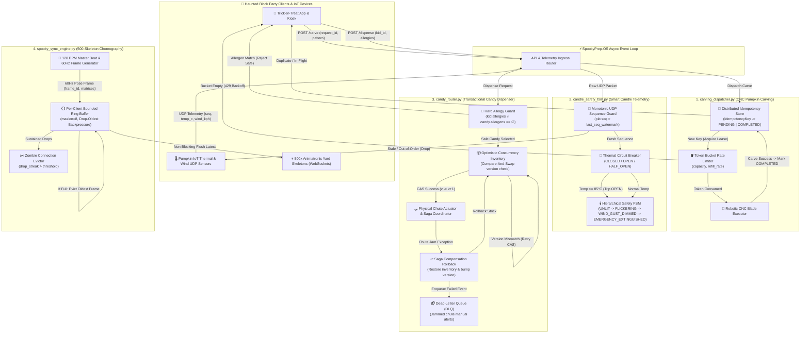
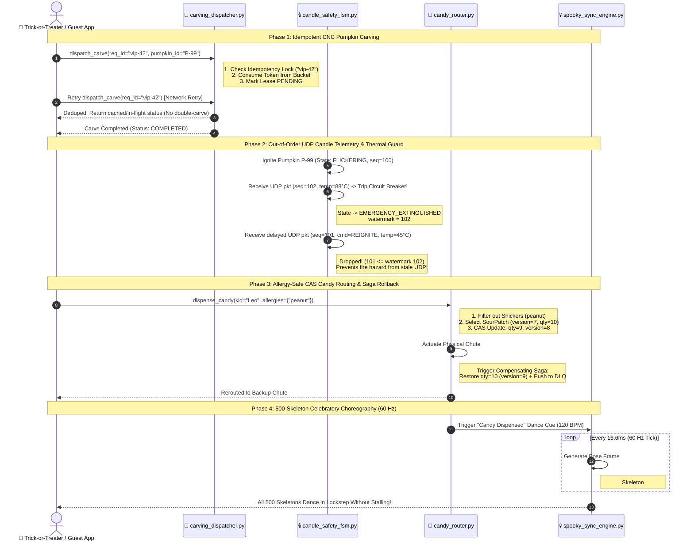
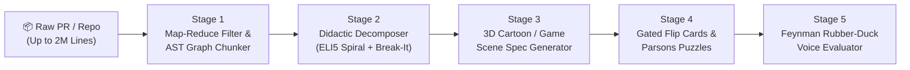

# SpookyPrep-OS: Halloween Pumpkin & Party Preparation Platform
## Target Mock Application & Vibe Didactics Deconstruction Architecture

> [!IMPORTANT]
> **Purpose of This Document**: `SpookyPrep-OS` is the canonical **medium-to-hard distributed systems mock repository** bundled with **Vibe Didactics**. It represents the exact kind of high-concurrency, multi-invariant backend code that developers "vibe-code" in minutes using AI coding agents—producing software that *passes happy-path tests* yet hides subtle concurrency, ordering, transactional, and backpressure failure modes that the human author does not fully understand.

---

## 1. The Target Mock Application: `SpookyPrep-OS`

### 1.1 Why a Developer "Vibe-Coded" This—and Why It Is Hard to Understand Without Didactic Tooling

On October 30th at 11:00 PM, a developer decides to automate their neighborhood's massive Halloween Haunted Block Party. Using an AI coding assistant, they prompt:
> *"Build me a fast, production-grade async Python backend that dispatches robotic CNC pumpkin carvers, monitors smart IoT LED/flame candles inside pumpkins over UDP, routes allergy-safe trick-or-treat candy chutes with inventory tracking, and synchronizes 500 animatronic yard skeletons to a 120 BPM spooky soundtrack over WebSockets. Make sure it never double-carves a pumpkin, catches fire, serves peanuts to allergic kids, or lags the dance floor!"*

Within 90 seconds, the LLM generates four dense modules (~500 lines of compact, idiomatic Python). The developer glances at it, sees clean type hints and green unit tests, and merges it. **This is the quintessential "Vibe-Coding Comprehension Gap":**

| Subsystem | What the Vibe-Coder *Thinks* It Does | What the AI *Actually* Generated Under the Hood | Hidden Failure Mode If Modified Naively |
| :--- | :--- | :--- | :--- |
| **`carving_dispatcher.py`** | "Queues up pumpkin carving jobs and limits speed." | **Token Bucket Rate Limiter** coupled with a **Two-Phase Distributed Idempotency Lock** (`PENDING` → `COMPLETED`) with lease TTL expiration. | Moving the lock check after the `await` point or forgetting to release on exception either **shreds the same pumpkin twice** (TOCTOU race) or permanently wedges the queue. |
| **`candle_safety_fsm.py`** | "Turns pumpkin candles on/off and shuts down if too hot." | **Hierarchical Finite State Machine (FSM)** guarded by a **Monotonic UDP Sequence Watermark** and a **Thermal Circuit Breaker** (`CLOSED` → `OPEN` → `HALF_OPEN`). | Removing the UDP sequence guard allows delayed/reordered network packets (`seq=41` arriving after `seq=42`) to **re-ignite a candle during a thermal emergency**. |
| **`candy_router.py`** | "Checks allergies and subtracts 1 from candy inventory." | **Strict Allergy Set-Intersection Guard** + **Optimistic Concurrency Control (CAS `version`)** + **Compensating Saga Rollback** + **Dead-Letter Queue (DLQ)**. | Mutating inventory in-place without incrementing/checking `expected_version` causes **lost updates under concurrent trick-or-treat bursts**; skipping the Saga compensation leaks phantom inventory when the physical chute jams. |
| **`spooky_sync_engine.py`** | "Broadcasts dance keyframes to 500 WebSocket skeletons." | **60 Hz Frame Broadcaster** using per-client **Bounded Ring Buffers** (`maxlen=8`) with **Drop-Oldest Real-Time Backpressure** and slow-consumer eviction. | Replacing bounded `Drop-Oldest` queues with unbounded queues or blocking `await send()` allows **a single Wi-Fi-lagging skeleton at the edge of the yard to stall all 499 other skeletons** and trigger an OOM crash. |

Without **Vibe Didactics**, reading these 4 files feels like staring at a wall of state transitions, version numbers, sequence counters, and ring buffers. With **Vibe Didactics**, each hidden invariant is isolated, translated into a 4-tier spiral explanation, visualized as a **3D interactive cartoon simulation**, and stress-tested via **"Break-It" counterfactual code mutations**.

---

### 1.2 Full System Architecture Diagram (`flowchart TD`)

The diagram below illustrates how external Halloween party traffic flows through the API Gateway into the four core subsystems of `SpookyPrep-OS`, highlighting the concurrency primitives, state guards, and failure recovery paths inside each module.

---

### 1.3 End-to-End Subsystem Interaction Sequence (`sequenceDiagram`)

During peak Halloween night traffic (7:30 PM), all four subsystems operate concurrently as a unified party orchestration pipeline: carving a custom pumpkin for an arriving VIP guest, igniting and monitoring its smart candle, dispensing allergy-safe candy when the guest approaches the porch, and triggering a synchronized 500-skeleton celebratory dance routine.

---

### 1.4 Deep-Dive into the Four Subsystems

#### 1. `carving_dispatcher.py` — Token Bucket + Distributed Idempotency Lock
- **Core Responsibility**: Protects a fleet of high-speed robotic CNC pumpkin carving blades from mechanical overload and duplicate execution when mobile clients retry requests over spotty yard Wi-Fi.
- **Key Architectural Primitives**:
  - `TokenBucket`: Replenishes carving capacity continuously at `refill_rate` tokens/sec up to `capacity`, rejecting bursts that would overheat stepper motors.
  - `IdempotencyRecord` (`PENDING` | `COMPLETED` | `FAILED`): Checks and acquires an atomic lock keyed by `request_id` **before** yielding to async I/O. If a retry arrives while the first request is in flight (`PENDING` with valid TTL) or already finished (`COMPLETED`), it returns the existing state instead of issuing a second CNC cut command that would destroy the pumpkin.

#### 2. `candle_safety_fsm.py` — Hierarchical FSM + UDP Sequence Watermark + Thermal Circuit Breaker
- **Core Responsibility**: Processes high-frequency UDP telemetry packets from smart candles inside carved pumpkins, adapting flame intensity to wind gusts and immediately cutting power if internal pumpkin temperature approaches ignition thresholds.
- **Key Architectural Primitives**:
  - **Monotonic Sequence Watermark (`last_seq`)**: Because UDP offers no ordering guarantees, a stale `FLICKER_NORMAL` packet sent *before* a thermal spike can arrive *after* the `EMERGENCY_EXTINGUISH` packet. Every packet with `pkt.seq <= state.last_seq` is strictly discarded at ingress.
  - **Thermal Circuit Breaker**: Once `temp_c >= 85.0`, the circuit breaker trips `OPEN` and transitions the FSM to `EMERGENCY_EXTINGUISHED`. It refuses all re-ignition commands until the cooldown timer elapses *and* a `HALF_OPEN` thermal probe confirms `temp_c <= 40.0`.

#### 3. `candy_router.py` — Allergy Guard + Optimistic CAS (`version`) + Distributed Saga Rollback + DLQ
- **Core Responsibility**: Routes trick-or-treat requests to automated candy chutes while enforcing zero-tolerance allergen filtering and maintaining exact inventory consistency across concurrent requests and mechanical chute failures.
- **Key Architectural Primitives**:
  - **Hard Allergy Set-Intersection Guard**: Computes `kid.allergies.intersection(bin.allergens)` prior to any inventory reservation; any non-empty intersection is rejected at the domain boundary.
  - **Compare-And-Swap (`version`) Inventory Update**: Reads `(qty, version)` and commits `(qty - 1, version + 1)` only if `current_version == expected_version`, preventing two simultaneous requests from decrementing the same counter snapshot.
  - **Compensating Saga + DLQ**: Because physical servo chutes cannot participate in a database rollback, a hardware jam after the CAS commit triggers an explicit compensating transaction (`qty + 1`, `version + 1`) and publishes a diagnostic payload to the `DeadLetterQueue`.

#### 4. `spooky_sync_engine.py` — 500-Skeleton WebSocket Choreography + Bounded Ring Buffer + Drop-Oldest Backpressure
- **Core Responsibility**: Broadcasts 60 Hz skeletal joint-transformation keyframes synchronized to a 120 BPM Halloween audio track across 500 yard skeletons over unreliable outdoor Wi-Fi.
- **Key Architectural Primitives**:
  - **Per-Client Bounded Ring Buffer (`collections.deque(maxlen=8)`)**: Decouples the master 60 Hz frame clock from individual client socket write speeds.
  - **Drop-Oldest Real-Time Backpressure**: For real-time choreography, *freshness beats completeness*. When a skeleton's socket buffer fills up, appending a new keyframe automatically evicts the oldest unconsumed frame so the skeleton snaps directly to the current beat when connectivity recovers, rather than playing stale dance moves 3 seconds behind the music or blocking the broadcast loop for the other 499 skeletons.

---

## 2. How the Vibe Didactics AI Pipeline Deconstructs This Repo

When a developer imports `SpookyPrep-OS` (or a massive enterprise PR containing it) into **Vibe Didactics**, our 5-stage AI pedagogical pipeline transforms opaque code into an interactive, multi-sensory mastery loop.

---

### Stage 1: 2M-Line PR Map-Reduce Filter & AST Graph Chunker

Large vibe-coded commits often mix critical distributed-systems logic with thousands of lines of lockfiles, generated assets, CSS tweaks, and boilerplate. Stage 1 distills the signal from the noise before invoking deep reasoning models:

1. **Tier 1 Deterministic Noise Stripper**: Immediately prunes lockfiles (`package-lock.json`, `poetry.lock`), vendored directories, minified bundles, SVG/3D mesh assets, and formatting-only diffs—typically reducing a 2M-line repository snapshot by **85–95%** in milliseconds.
2. **Tier 2 AST Structural & Cyclomatic Scoring**: Parses the remaining Python/TypeScript files into Abstract Syntax Trees (`ast`), scoring each function and class by **Concurrency Density** (`async`/`await`, locks, queues), **State Mutation Complexity** (FSM transitions, CAS version checks, exception handlers), and **Call-Graph Centrality**.
3. **Tier 3 Semantic Concept Clustering**: Groups tightly coupled AST nodes into cohesive **Didactic Concept Nodes** (e.g., pairing `TokenBucket.consume` + `CarvingDispatcher.dispatch` into Concept #1, and `CandleSafetyFSM.on_packet` + `ThermalCircuitBreaker` into Concept #2) with explicit dependency edges so the learner masters foundational invariants before composite workflows.

---

### Stage 2: Didactic Decomposer (ELI5 Spiral Levels + Counterfactual "Break-It" Mutations)

For each AST Concept Cluster extracted in Stage 1, Stage 2 generates a structured pedagogical payload built on two pillars:

#### A. 4-Level Spiral Curriculum (Bruner's Spiral Progression)
Instead of dumping a single wall of technical jargon, every subsystem can be scrubbed dynamically across four comprehension altitudes:
- **Level 1 (`ELI5` / Cartoon Metaphor)**: *E.g., for `spooky_sync_engine.py`*: "Imagine a dance teacher shouting moves to 500 skeletons. If one skeleton covers its ears, the teacher doesn't stop the music for everyone else—they toss old dance cards in the trash so the sleepy skeleton can jump right back onto the current beat!"
- **Level 2 (`Intuitive` / Mental Model)**: Explains why real-time media/choreography streams prefer **Drop-Oldest bounded queues** over blocking TCP queues (head-of-line blocking vs. temporal freshness).
- **Level 3 (`Architectural` / Invariants & Contracts)**: Formalizes the O(1) non-blocking fan-out invariant, bounded memory ceiling (`500 clients × 8 frames`), and slow-consumer eviction thresholds.
- **Level 4 (`Production Line-by-Line` / Edge Cases)**: Walks directly through the exact Python lines (`deque(maxlen=8)`, watermark comparisons, CAS version increments) and inspects production failure modes.

#### B. Counterfactual "Break-It" Engine
Passive reading creates an *illusion of competence*. To prove *why* each AI-generated guard exists, Stage 2 synthesizes targeted **Counterfactual Code Mutations ("Break-It" Toggles)** for every module:

| Module | Healthy Production Invariant | Counterfactual "Break-It" Mutation | Simulated Catastrophe Observed by Learner |
| :--- | :--- | :--- | :--- |
| `carving_dispatcher.py` | Check & acquire `request_id` lock *before* `await blade.carve()` | Move idempotency record write *after* `await blade.carve()` | Concurrent network retry slips through the `await` gap → **Two CNC lasers carve the same pumpkin simultaneously, slicing it into mush!** |
| `candle_safety_fsm.py` | Drop UDP packet if `pkt.seq <= last_seq` | Disable UDP sequence watermark check | Delayed packet `seq=101 (FLICKER)` arrives after `seq=102 (88°C EMERGENCY)` → **Candle re-ignites inside an overheating pumpkin!** |
| `candy_router.py` | CAS `version` check + Saga compensation on chute jam | Mutate `qty -= 1` without version check or rollback | Two kids tap at once → **Inventory goes negative, and a jammed chute permanently eats the last allergy-safe candy!** |
| `spooky_sync_engine.py` | Per-client `deque(maxlen=8)` with Drop-Oldest | Use unbounded blocking `await ws.send()` in broadcast loop | Skeleton #500 walks behind a shed (bad Wi-Fi) → **All 499 other skeletons freeze mid-dance waiting for Skeleton #500's TCP ACK!** |

---

### Stage 3: 3D Cartoon / Game Engine Scene Specification

Stage 3 translates each Concept Node and its "Break-It" state into a declarative **3D Cartoon Scene Specification JSON** rendered interactively in the browser (via Three.js / React Three Fiber / Procedural Low-Poly Actors):

- **Scene 1 (`Carving Workshop`)**: A conveyor belt of glowing 3D pumpkins entering a Dual-Laser CNC rig, guarded by a floating translucent **Token Jar** (filling with glowing tokens) and a **Bouncer Clipboard** (Idempotency Key table). Toggling **"Break-It"** spawns twin retry ghosts that bypass the Bouncer and cross the laser beams until the pumpkin explodes into voxel chunks.
- **Scene 2 (`Haunted Porch Candle Lab`)**: A giant carved Jack-o'-Lantern with an internal thermometer gauge, animated wind puffs, and numbered UDP paper airplanes flying toward it. Toggling **"Break-It"** lets a slow, out-of-order `#101` airplane fly past the `#102` fire extinguisher and set the pumpkin ablaze.
- **Scene 3 (`Allergy-Safe Candy Vault`)**: Color-coded candy chutes with an **Allergy Scanner Shield**, a spinning **CAS Version Odometer** (`v7 → v8`), and a mechanical trapdoor. Toggling **"Break-It"** jams the trapdoor without firing the **Saga Rewind Spring**, leaving the kid empty-handed while the inventory counter stays permanently wrong.
- **Scene 4 (`500-Skeleton Graveyard Rave`)**: A neon graveyard stage where skeleton dancers groove in lockstep to 120 BPM waves radiating from a DJ booth, each skeleton wearing a floating 8-slot **Ring Buffer Halo**. Toggling **"Break-It"** chains all skeletons together with a blocking rope—when one edge skeleton trips in mud, the entire dance floor grinds to a halt.

---

### Stage 4: Gated Post-Scene Flip Cards & Parsons Puzzles

Before a learner can mark a module "Understood" or approve the PR, Stage 4 unlocks an active-recall verification gate directly tied to the 3D simulation they just manipulated:

1. **Invariant Flip Cards**: High-contrast diagnostic cards asking *why* a specific line of code is structured the way it is (e.g., *"Why does `candle_safety_fsm.py` track BOTH a `ThermalCircuitBreaker` state AND a `last_seq` UDP watermark?"*) with visual causal breakdowns on the flip side.
2. **Interactive Parsons Puzzles (Drag-and-Drop Code Reconstruction)**: Scrambles the critical 5–7 lines of the concurrency or transactional invariant (such as the CAS check → Chute Actuation → `except ChuteJamError:` → Saga Rollback → DLQ enqueue in `candy_router.py`) alongside plausible distractor lines (e.g., rolling back *before* catching the error or forgetting to increment the CAS version). The learner must reconstruct the exact execution order to restore the green safety state.

---

### Stage 5: Feynman Rubber-Duck Voice Evaluation

The final mastery gate applies **Richard Feynman's Learning Technique**: *you only truly understand a system when you can explain its failure modes simply in your own words*.

1. **Prompted Voice / Text Challenge**: A 3D animated **Haunted Rubber Duck (Professor Quackula)** asks the developer a targeted scenario question, such as:
   > *"Suppose Skeleton #412 has flaky Wi-Fi at the edge of the yard, and at the same time two kids with peanut allergies press the candy button within 2 milliseconds of each other. Walk me through how `SpookyPrep-OS` prevents both a frozen dance floor and a double-dispense disaster!"*
2. **Rubric-Guided Semantic Grading**: The Stage 5 evaluator transcribes the user's explanation and scores it against the Concept Node's **Required Causal Checkpoints**:
   - Did the user explain *Drop-Oldest bounded ring buffers* vs. head-of-line blocking?
   - Did the user mention *pre-reservation allergen set filtering* and *Compare-And-Swap (`version`) optimistic locking*?
   - Did the user account for *compensating Saga rollback* if the physical chute jams?
3. **Adaptive Socratic Follow-Up**: If the developer gives a vague "vibe-level" answer (*"It uses async queues and checks the database"*), Professor Quackula pinpoints the exact missing link, re-highlights the corresponding 3D actor in Stage 3, and asks a focused follow-up question until genuine architectural mastery is achieved.
