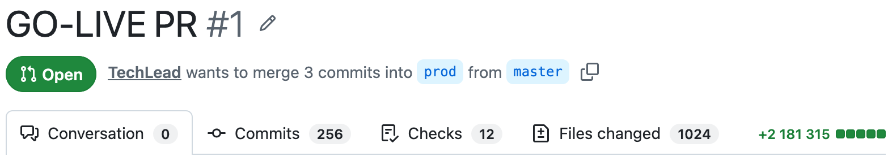

# Vibe Didactics — 3-Slide Hackathon Pitch Deck

---

## Slide 1: Title & Team

# **Vibe Didactics**
### Understand massive AI-generated PRs in 60 seconds through **10s Cartoons** & **Flip Cards**.

**Team:**
- **Mikhail Solonin** *(+ add teammates here)*

---

## Slide 2: Who We Target & The Problem

# **For Engineers & Product Builders.**
### Understand how your AI-built app actually works—and **what cloud & services you pay for**.

---

## Slide 3: Our Solution & Live Demo

# **Turn Any Massive PR Into a 60-Second Visual Lesson**

1. **🗺️ Service Graph** — Spots critical service interactions inside huge AI commits.
2. **🎬 10s "Break-It" Cartoons** — Shows how the logic works—and what explodes if you delete a line.
3. **🃏 Flip Cards & Voice** — Quick active-recall check before the Tech Lead hits Merge.

> **🎃 Live Demo:** Reviewing *"Google Halloween Mode"* (18 Services)
